  

  
  
  
  

## 👋 About me

I am a Computer Engineering fresh graduate from the Faculty of Engineering, University of Ruhuna, Sri Lanka. My main focus is AI/ML and data science, and I am also a full-stack engineer, so I take LLM agents, RAG systems, computer vision models and machine learning pipelines through to working products.

- 🎓 BSc Engineering (Hons) in Computer Engineering, University of Ruhuna (2022–2026)
- 💼 AI/ML Engineer Intern at SLT-Mobitel (June – November 2025), where I built a [RAG chat assistant](https://github.com/KesharaGunathilaka/SLT_AI_Chatbot) for the SLT website on Llama 3.1 running locally through Ollama
- 🧠 Working across LLM agents, RAG, computer vision, ML pipelines and full-stack web development
- 🏆 Global Rank #49 at IEEEXtreme 19.0 and 2nd Runners-Up at AGENTRIX 2026
- 🔭 Open to AI/ML, data science and full-stack engineering roles

## 🛠️ Tech stack

| Area | Tools |
| :-- | :-- |
| **Languages** | `Python` `C++` `C` `SQL` `JavaScript` `TypeScript` |
| **AI and machine learning** | `PyTorch` `scikit-learn` <code>Hugging&nbsp;Face&nbsp;Transformers</code> `Sentence-Transformers` `YOLO` `OpenCV` `MediaPipe` `Pandas` `NumPy` `Matplotlib` |
| **LLMs and agents** | `RAG` `LangGraph` `Ollama` `Groq` <code>Google&nbsp;Gemini</code> `MCP` `ChromaDB` <code>Milvus&nbsp;/&nbsp;Zilliz</code> |
| **Data** | `PostgreSQL` `MySQL` `MongoDB` <code>Apache&nbsp;Spark</code> <code>Apache&nbsp;Airflow</code> <code>Apache&nbsp;Kafka</code> `MLflow` |
| **Web** | `React` `Next.js` <code>Tailwind&nbsp;CSS</code> `Node.js` `Express` `NestJS` `FastAPI` `Flask` `GraphQL` |
| **DevOps and tools** | `Docker` `Kubernetes` <code>GitHub&nbsp;Actions</code> <code>AWS&nbsp;EC2</code> `Git` `Linux` |

## 🏆 Achievements

| | Result | Event |
| :-: | :-- | :-- |
| 🌍 | **Global Rank #49** | IEEEXtreme 19.0, among 19,000+ participants worldwide |
| 🥉 | **2nd Runners-Up** | AGENTRIX 2026 inter-university competition, with CommuteAI |
| 🏁 | **Finalist** | Rootcode Tech-Triathlon 2026, with Waypoint |
| 🏁 | **Finalist** | AI EXPO Codeblast |
| 🏅 | **44th in Sri Lanka** | IEEEXtreme 18.0 |
| 🎯 | **Top 10 of 200+** | ZuuCrew AI Academy, Building Production-Ready Machine Learning Systems |

**Leadership:** Industry Engagement Committee Lead at the IEEE Student Branch, University of Ruhuna (2025/2026), and Executive Committee Member at SEDS Ruhuna, named Best Overall SEDS Chapter in Sri Lanka 2025.

## 🚀 Featured projects

<table>
  <tr>
    <td width="50%" valign="top">
      <h3>🤖 <a href="https://github.com/KesharaGunathilaka/adaptive-multimodal-hri">Adaptive Multimodal Human–Robot Interaction</a></h3>
      
<b>🎓 Final-year project</b>

      
Four perception models for scene context, emotion, gesture and motion feed a self-attention fusion layer that predicts intent in real time, running on an NVIDIA Jetson with an Intel RealSense depth camera.

      
<code>PyTorch</code> <code>MediaPipe</code> <code>NVIDIA&nbsp;Jetson</code> <code>Intel&nbsp;RealSense</code>

    </td>
    <td width="50%" valign="top">
      <h3>🚌 <a href="https://github.com/KesharaGunathilaka/commute_ai-agentrix">CommuteAI</a></h3>
      
<b>🥉 2nd Runners-Up, AGENTRIX 2026</b>

      
A LangGraph agent that plans Sri Lankan bus and train journeys, detects live disruptions and replans automatically, in Sinhala, Tamil and English.

      
<code>LangGraph</code> <code>Groq</code> <code>ChromaDB</code> <code>FastAPI</code>

    </td>
  </tr>
  <tr>
    <td width="50%" valign="top">
      <h3>🎬 <a href="https://github.com/KesharaGunathilaka/lumeo-movie-mcp-aai">Lumeo</a></h3>
      
<b>AI movie recommendation and insight platform</b>

      
Two LangGraph agents pair SVD collaborative filtering with embeddings for personalised and mood-based recommendations, with fine-tuned DistilBERT sentiment and every capability exposed as MCP tools.

      
<code>LangGraph</code> <code>Groq</code> <code>FastAPI</code> <code>Next.js</code> <code>MCP</code>

    </td>
    <td width="50%" valign="top">
      <h3>📐 <a href="https://github.com/KesharaGunathilaka/architectural-floor-plan-digitization_ipcv">Floor Plan Digitization</a></h3>
      
<b>Computer vision · Team project</b>

      
YOLOv11 extracts doors, windows, walls and fixtures from scanned floor plans, reaching mAP@50 of 0.838 on CubiCasa5k, and exports them as CAD-compatible DXF and JSON.

      
<code>YOLO</code> <code>PyTorch</code> <code>OpenCV</code> <code>DXF</code>

    </td>
  </tr>
  <tr>
    <td width="50%" valign="top">
      <h3>🚚 <a href="https://github.com/KesharaGunathilaka/AlphaZero_Waypoint">Waypoint</a></h3>
      
<b>🏁 Finalist, Rootcode Tech-Triathlon 2026</b> · <a href="https://alpha-zero-waypoint.vercel.app/">Live&nbsp;demo</a>

      
Delivery planning for three retail brands across two depots: a rule-aware allocation engine, offline-ready loader and driver apps, live dispatch monitoring, and LightGBM demand and lateness models.

      
<code>Next.js</code> <code>FastAPI</code> <code>PostgreSQL</code> <code>LightGBM</code>

    </td>
    <td width="50%" valign="top">
      <h3>📨 <a href="https://github.com/KesharaGunathilaka/kafka-order-stream-bigdata">Kafka Order Stream</a></h3>
      
<b>Streaming data pipeline</b>

      
Avro-serialised order streaming with real-time price aggregation, retries with exponential backoff, and a dead letter queue for messages that cannot succeed.

      
<code>Kafka</code> <code>Avro</code> <code>Python</code> <code>Docker</code>

    </td>
  </tr>
</table>

**More work:** [BookBuddies](https://github.com/KesharaGunathilaka/bookbuddies-cloud-k8s), FastAPI microservices on GKE with Terraform and GitHub Actions, and [Sayido.lk](https://github.com/KesharaGunathilaka/wedding-directory), a multi-vendor wedding planning platform built with Next.js, NestJS and GraphQL.

## 📊 GitHub activity

  <picture>
    <source media="(prefers-color-scheme: dark)" srcset="https://raw.githubusercontent.com/KesharaGunathilaka/KesharaGunathilaka/main/profile/stats-dark.svg">
    
  </picture>
  &nbsp;
  <picture>
    <source media="(prefers-color-scheme: dark)" srcset="https://raw.githubusercontent.com/KesharaGunathilaka/KesharaGunathilaka/main/profile/top-langs-dark.svg">
    
  </picture>

  <picture>
    <source media="(prefers-color-scheme: dark)" srcset="https://raw.githubusercontent.com/KesharaGunathilaka/KesharaGunathilaka/main/profile/snake-dark.svg">
    
  </picture>

  

  <b>Get in touch:</b> &nbsp;<a href="https://www.linkedin.com/in/keshara-gunathilaka">LinkedIn</a> &nbsp;·&nbsp; <a href="mailto:gpkhgunathilaka@gmail.com">Email</a> &nbsp;·&nbsp; <a href="https://github.com/KesharaGunathilaka/KesharaGunathilaka/raw/main/assets/Keshara_Gunathilaka_CV.pdf">CV</a>

